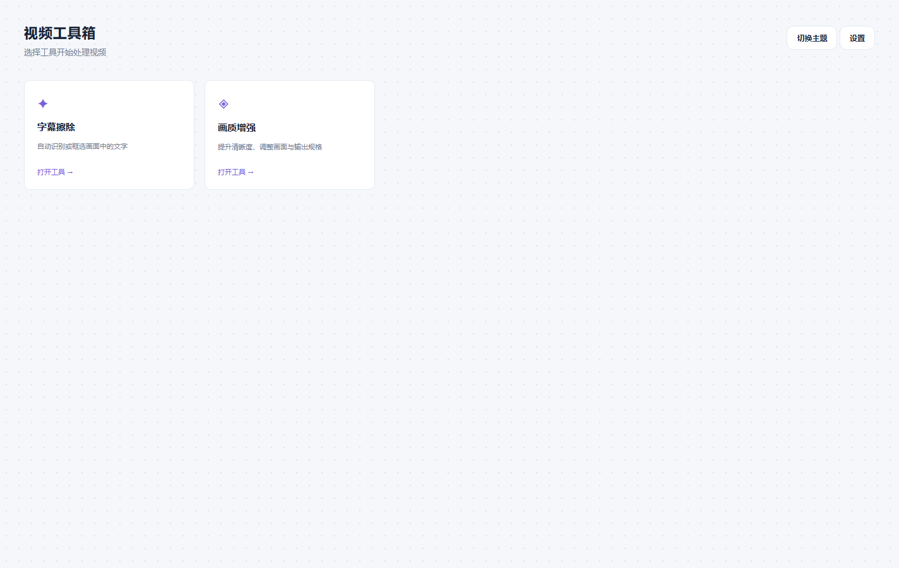

# SubtitleEraser · 视频工具箱

在 Windows 上擦除视频字幕和画面文字，或增强视频清晰度。处理完成后，可以同步播放原片和成片，拖动分隔线查看同一帧的变化。

**[下载 Windows 正式版（x64）](https://github.com/sangui0312/Subtitle-Eraser/releases/latest)**　·　[1.3.1 更新测试版](https://github.com/sangui0312/Subtitle-Eraser/releases/tag/v1.3.1)　·　[全部版本与更新记录](https://github.com/sangui0312/Subtitle-Eraser/releases)

在发布页的 **Assets** 中下载以 `-x64.exe` 结尾的安装包。日常使用请选择正式版；1.3.1 用于验证更新包下载，功能与 1.3.0 相同。



## 选择工具

| 工具 | 适用场景 | 可选设置 |
| --- | --- | --- |
| 字幕擦除 | 清除画面下半部的硬字幕，或识别整幅画面中的叠加文字 | 自动识别或手动框选最多 20 个区域，可仅处理或跳过指定片段 |
| 画质增强 | 提升清晰度，调整画面与输出规格 | 标准版、专业版、极速版和大模型版，各版本的可调参数在工作台内显示 |

## 快速开始

1. **安装。** 运行 Windows 安装包。选择父目录后，安装器会自动创建 `SubtitleEraser` 文件夹。
2. **配置服务。** 打开首页「设置」，保存具备相应视频处理权限的火山引擎 API Key。视频会提交到云端处理，服务费用按账号规则计算。
3. **添加视频。** 在首页选择「字幕擦除」或「画质增强」，添加本地视频或 HTTP/HTTPS 视频直链。
4. **处理并保存。** 在右侧设置参数和成片保存位置，点击「开始擦除」或「开始增强」。完成后可预览结果、双击进入对比窗口，或打开成片文件夹。

使用 1.0.0 的用户请手动下载安装新版。支持在线更新的版本可在设置中检查更新。

## 字幕擦除参数

- 默认 V5，适合中英文字幕。V5.6 支持更多语种，处理时间更长。
- 字幕模式对应 `Subtitle`，处理画面下半部分的字幕，框选时取与下半部分的交集。
- 画面文字模式对应 `Text`，检测整个画面的字幕、人名、地名等叠加文字，框选时限定在选区内。
- 默认范围和手动框选可分别配合上述两种处理模式，手动框选最多支持 20 个区域。
- 时间段支持仅处理指定片段或跳过指定片段，起止时间以秒填写。
- 字幕识别高级设置可调整文字最小高度、最大高度和水平居中偏移，仅对字幕模式生效。
- 输入最高 2K，输出最高 1080P，单个本地文件最大 5 GB。
- 云端算法可能在复杂背景和动画文字上留下残留，具体效果由服务决定。
- MP4/H.264 通常可以直接预览。部分容器或编码无法在内置播放器中预览，仍可使用自动识别提交。

## 数据与恢复

- 本机设置和任务记录位于 `%APPDATA%\SubtitleEraser`。
- API Key 使用 Electron safeStorage 调用 Windows 加密能力保存，界面只显示配置状态。
- 默认成片位置为当前用户的视频文件夹下的“字幕擦除”，可在界面中更改。已排队任务使用开始时确定的保存位置。
- 重新打开软件后，已取得任务 ID 的任务继续查询或下载。尚未提交的任务恢复为待开始。
- 提交结果不确定时保留原请求。23 小时内可使用同一个 Key 和请求标识恢复提交，超出时间需在火山控制台核对。
- 查询与下载重试复用原任务。默认云端成片链接自生成起有效 24 小时，软件会自动下载。
- 关闭软件后，已提交的云端任务继续执行。再次打开后继续获取结果。
- 总耗时从实际执行开始计算，涵盖上传、处理和成片保存。云端任务耗时取接口创建至完成的时间差，缺少时间记录时显示未记录。

## 开发与验证

使用 Node.js 24。

```powershell
npm install
npm run dev
npm test
npm run verify:installer
npm run dist:win
```

`npm run smoke` 使用 `validation/fixture.mp4` 和隔离的测试数据目录，模拟上传、提交、查询和下载流程。验证包含窗口布局、视频播放、鼠标框选及密钥加密。测试入口仅在开发模式可用，安装包使用真实官方接口。

本次验证使用模拟上游，真实 API 权限、账户余额和实际字幕擦除效果需要配置自己的 Key 后验证。

## 发布新版

安装目录规则位于 `AGENTS.md`。`build.beforePack` 自动执行 `tools/check-installer.cjs`，默认软件文件夹配置不满足规则时会阻止打包。按维护者要求仅做静态配置检查。发布前核对安装包版本和更新文件哈希，上传草稿附件后核对大小及哈希，公开后下载复核。

修改 `package.json` 的版本号并同步锁文件，运行测试、窗口验证和 Windows 打包。发布前保存上一版源码和安装包，核对打包内容与源文件一致。

将对应版本的安装包、`.exe.blockmap` 和 `latest.yml` 一起上传至 GitHub Releases，先建立草稿并校验文件，再公开发布。标签使用 `v版本号`。更新信息由构建生成，客户端会校验下载文件的 SHA512。

项目源代码和发行包均使用独立文件清单。个人数据、视频、密钥、测试数据、日志和本机依赖保存在各自的本地目录。

## 官方文档

- [精细化字幕擦除 API](https://docs.volcengine.com/docs/intelligent-processing/erase-video-subtitle-pro?lang=zh)
- [视频上传](https://docs.volcengine.com/docs/intelligent-processing/media-input-and-upload?lang=zh)
- [计费说明](https://docs.volcengine.com/docs/intelligent-processing/video-tool-billing?lang=zh)
